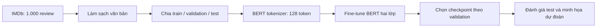

<div align="center">

# IMDb Sentiment Analysis with BERT

**Phân loại cảm xúc đánh giá phim bằng mô hình BERT**

[](https://github.com/doanhoainamdz/bert-imdb-sentiment-analysis/actions/workflows/validate.yml)


</div>

Notebook nghiên cứu quy trình fine-tuning `bert-base-uncased` để phân loại review phim tiếng Anh thành hai nhãn **tích cực** và **tiêu cực**. Dự án bao gồm khảo sát dữ liệu, tiền xử lý văn bản, token hóa, huấn luyện, lựa chọn checkpoint và đánh giá.

**[Mở notebook chính](bert_imdb_sentiment_analysis.ipynb)** · **[Hướng dẫn chạy lại](docs/REPRODUCIBILITY.md)**

> **Trạng thái:** Phần thuyết minh đã được biên tập; code và output lịch sử được giữ nguyên. Notebook còn các điểm cần sửa trước khi chạy lại từ đầu, được ghi ở mục 12 và hướng dẫn tái lập. Kiểm tra tự động của kho chỉ xác nhận cấu trúc notebook, không chạy huấn luyện hay xác nhận accuracy.

## Bài toán và dữ liệu

Đầu vào là một đánh giá phim tiếng Anh. Mô hình dự đoán một trong hai nhãn:

| Nhãn | Mã | Ý nghĩa |
|---|---:|---|
| `negative` | 0 | Tiêu cực |
| `positive` | 1 | Tích cực |

Nguồn dữ liệu: [IMDb Dataset of 50K Movie Reviews trên Kaggle](https://www.kaggle.com/datasets/lakshmi25npathi/imdb-dataset-of-50k-movie-reviews). Code hiện chọn **1.000 dòng đầu tiên** từ CSV, gồm 501 review tích cực và 499 review tiêu cực theo output đã lưu. Đây không phải mẫu ngẫu nhiên hoặc toàn bộ tập 50.000 review.

| Phân hoạch | Số mẫu | Mục đích |
|---|---:|---|
| Train | 700 | Cập nhật trọng số |
| Validation | 150 | Lựa chọn checkpoint |
| Test | 150 | Đánh giá sau khi chọn checkpoint |

Hai lần chia dùng `random_state=42`; code chưa dùng `stratify` và chưa kiểm tra review trùng lặp trước khi chia.

## Quy trình thực nghiệm



Notebook có 13 phần, từ giới thiệu mô hình và dữ liệu đến kết quả, hạn chế, lưu trữ mô hình, điều kiện tái lập và tài liệu tham khảo. Tham khảo [bài báo BERT](https://arxiv.org/abs/1810.04805) và [thông tin checkpoint](https://huggingface.co/google-bert/bert-base-uncased).

## Cấu hình và kết quả được lưu

| Thiết lập | Giá trị |
|---|---|
| Mô hình | `bert-base-uncased` + bộ phân loại 2 lớp |
| Chiều dài tối đa | 128 token |
| Batch size | 16 |
| Số epoch | 5 |
| Optimizer | AdamW |
| Learning rate | `2e-5` |
| Scheduler | Linear, không warm-up |
| Tiêu chí chọn checkpoint | Validation accuracy cao nhất |

| Epoch | Train loss | Validation loss | Validation accuracy |
|---:|---:|---:|---:|
| 1 | 0,6867 | 0,6386 | 60,00% |
| 2 | 0,4919 | 0,3927 | 80,67% |
| 3 | 0,2596 | 0,4227 | 78,67% |
| **4** | **0,1221** | **0,3908** | **84,00% — checkpoint được chọn** |
| 5 | 0,0818 | 0,4074 | 83,33% |

Output lịch sử ghi nhận **test accuracy 86,00% trên 150 review** và test loss 0,3323. Kết quả chưa được xác nhận bằng một lượt huấn luyện mới; không diễn giải đây là accuracy trên toàn bộ IMDb hoặc trên dữ liệu triển khai. Chưa có đối chứng, F1-score, confusion matrix hay đánh giá qua nhiều seed.

## Cài đặt và mở notebook

Python 3.11 được đề xuất để thuận tiện dùng môi trường tương tự các log cũ. GPU CUDA có thể hỗ trợ huấn luyện; code tự chuyển sang CPU nếu không có CUDA. Notebook không cấu hình TPU.

```bash
git clone https://github.com/doanhoainamdz/bert-imdb-sentiment-analysis.git
cd bert-imdb-sentiment-analysis
python -m venv .venv
```

Kích hoạt trên **Windows PowerShell**:

```powershell
.\.venv\Scripts\Activate.ps1
```

Trên **Linux/macOS**:

```bash
source .venv/bin/activate
```

Cài thư viện và mở JupyterLab:

```bash
python -m pip install --upgrade pip
python -m pip install -r requirements.txt
python -m jupyterlab
```

Mở `bert_imdb_sentiment_analysis.ipynb`, đọc mục 12 và [hướng dẫn chạy lại](docs/REPRODUCIBILITY.md) trước khi chạy tuần tự. Các khoảng phiên bản trong `requirements.txt` là môi trường đề xuất, chưa phải lockfile đã xác minh cho lần huấn luyện lịch sử.

## Những điểm cần xử lý trước khi chạy lại

1. **Đường dẫn CSV:** code tải dataset vào biến `path` nhưng đọc file từ `/kaggle/input/...`; cần dùng vị trí file thực tế.
2. **Từ viết tắt:** quy tắc `TIME` làm từ thông thường “time” thành “Tears in my eyes”; cần rà soát và đánh giá lại tiền xử lý.
3. **Demo:** lời gọi `predict_sentiment(..., device)` truyền thiết bị vào tham số `max_len`; cần gọi đúng chữ ký.
4. **Lưu mô hình:** các ô Google Drive chỉ chạy trong Colab. Kho chưa phân phối `best_model.pt`; cần huấn luyện để tạo checkpoint hoặc cung cấp checkpoint riêng.

Nếu thay đổi pipeline tiền xử lý, cần huấn luyện và đánh giá lại. Không dùng nguyên con số 86,00% để báo cáo cho pipeline đã thay đổi.

## Cấu trúc kho

```text
bert-imdb-sentiment-analysis/
├── bert_imdb_sentiment_analysis.ipynb  # Notebook chính và output lịch sử
├── README.md                         # Giới thiệu và kết quả
├── requirements.txt                  # Thư viện đề xuất
├── docs/
│   └── REPRODUCIBILITY.md             # Điều kiện và cách chuẩn bị chạy lại
├── scripts/
│   └── validate_notebook.py           # Kiểm tra cấu trúc, không thực thi code
└── .github/workflows/validate.yml     # Kiểm tra tự động trên GitHub
```

Dataset, môi trường Python, checkpoint và output sinh mới được loại khỏi Git bằng `.gitignore`. Chỉ notebook và tài liệu cần thiết được xuất bản trong kho này.

## Kiểm tra cấu trúc

```bash
python -m pip install nbformat
python scripts/validate_notebook.py
```

Kiểm tra này xác nhận file hợp lệ theo nbformat, các ô code có thể phân tích cú pháp sau khi nhận diện lệnh IPython, và không có mẫu token xác thực thông dụng. Nó không kiểm tra chất lượng mô hình, khả năng chạy toàn bộ notebook hoặc tính đúng đắn của output lịch sử.

## Tác giả và điều khoản sử dụng

Dự án của [Đoàn Hoài Nam](https://github.com/doanhoainamdz).

Kho chưa áp dụng giấy phép riêng cho mã và tài liệu của tác giả. Dữ liệu Kaggle, checkpoint BERT và các thư viện phụ thuộc có điều khoản sử dụng riêng; cần tham khảo nguồn tương ứng khi sử dụng lại.
